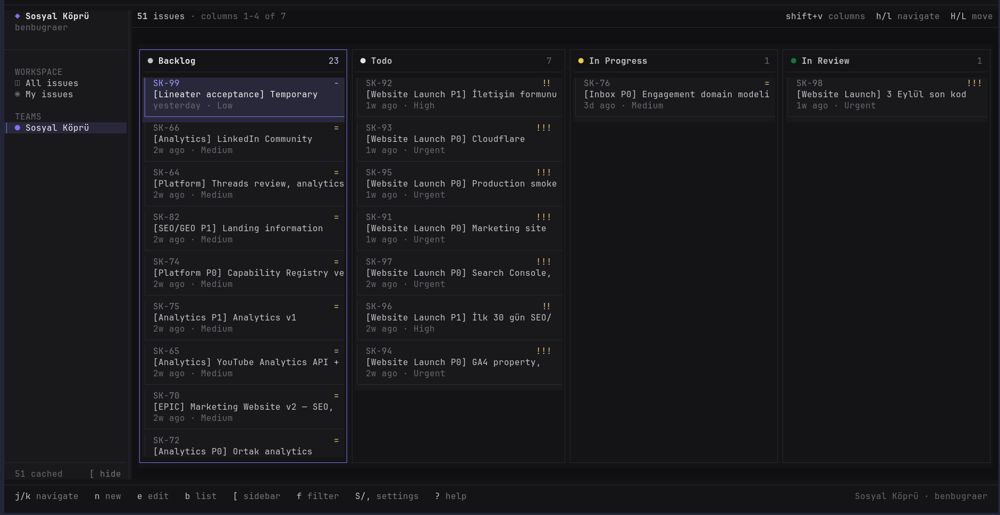

# Lineater

A fast, keyboard-first, scriptable Linear client for the terminal.

Cached issues render immediately. Vim navigation, a dynamic Kanban board, and clean JSON CLI commands stay on the official Linear API. Current release: **v0.1.0 — Public Preview**.



## Install

Linux and macOS, x64 and arm64. Bun and Node.js are not required:

```bash
curl -fsSL https://lineater.pages.dev/install | sh
```

The installer downloads the matching standalone binary, verifies its SHA-256 checksum, and installs it to `~/.local/bin/lineater`. If that directory is not on `PATH`, add it and restart your shell:

```bash
export PATH="$HOME/.local/bin:$PATH"
```

Then open Lineater:

```bash
lineater
```

Official releases already include Lineater's public OAuth client ID. On first launch choose **Authorize with Linear**. Lineater opens the system browser, completes OAuth 2.0 + PKCE, stores the credential in the OS secret store, syncs the workspace, and enters the TUI.

On Linux, an unlocked Secret Service implementation such as GNOME Keyring or KWallet must be available. Lineater will not store tokens in plaintext.

See [`CHANGELOG.md`](CHANGELOG.md), [`docs/DISTRIBUTION.md`](docs/DISTRIBUTION.md), and [`docs/SECURITY.md`](docs/SECURITY.md).

## Keyboard

```text
j / k       move down / up
h / l       move left / right
gg / G      first / last
Enter       open issue details or select
Esc         close or go back
n / e       create / edit issue
c           add a Markdown comment
s / a / p   status / assignee / priority
t           labels
P / C       project / cycle
/           search cached issues
f           team/state/project/cycle/assignee/priority/label filters
y / o       copy identifier / open issue in Linear
:           command palette
S / ,       settings and themes
?           help overlay
b           list / board
[           collapse / expand sidebar
Shift+V     choose visible Kanban columns
H / L       move issue across visible workflow states
Ctrl+E      edit long descriptions/comments in $EDITOR
Ctrl+S      save issue/comment composer
r           refresh from Linear
q           quit
```

Named normal-mode commands can be overridden in `~/.config/lineater/config.json`:

```json
{
  "keybindings": {
    "app.settings": "ctrl+,",
    "issue.copyIdentifier": "ctrl+y"
  }
}
```

`Ctrl+C` remains an emergency quit binding. Unknown commands are ignored.

The default theme is Linear Dark. Settings also include Linear Light, Catppuccin Latte/Frappé/Macchiato/Mocha, Tokyo Night, Nord, and Solarized Light.

Kanban columns come from each team's Linear workflow. `H`/`L` moves optimistically and rolls both the UI and SQLite cache back if Linear rejects the mutation.

## CLI

The same executable is scriptable. JSON on stdout is valid JSON only; diagnostics go to stderr.

```bash
lineater auth login
lineater auth status
lineater auth logout
lineater sync
lineater viewer
lineater teams --json
lineater states --json
lineater issues --team TEAM_UUID --state STATE_UUID --priority 2 --label LABEL_UUID --json
lineater create "Issue title" --team TEAM_UUID --priority 2 --json
lineater update ENG-123 --title "Updated title" --assignee none --json
lineater comment ENG-123 "Markdown comment" --json
lineater issues --offline --priority 2 --json
lineater issue ENG-123 --json
lineater issue ENG-123 --offline --json
lineater projects --json
lineater cycles --json
```

## Troubleshooting

| Symptom | What to do |
| --- | --- |
| `lineater: command not found` | Add `~/.local/bin` to `PATH` and restart the shell. |
| Browser says it cannot find the OAuth client | Official binaries should not need a client ID. For source builds, set a real Linear OAuth client ID—not a placeholder such as `your-public-client-id`. |
| Login fails on Linux after browser consent | Unlock GNOME Keyring, KWallet, or another Secret Service implementation. |
| Session expired / create fails after idle time | Press Enter on the authorization screen and sign in again. Pending composer drafts are preserved; save is not retried automatically. |
| Cached data looks stale | Press `r` for a full reconciliation. Linear remains the source of truth; `~/.local/share/lineater/lineater.db` can be deleted and rebuilt. |

## Development

Requirements: Bun 1.3.14+ on Linux or macOS.

```bash
bun install
bun run dev
```

The first run creates the cache at `$XDG_DATA_HOME/lineater/lineater.db`, falling back to `~/.local/share/lineater/lineater.db`. Override it with `LINEATER_DATABASE_PATH`.

Exit the TUI with `q` or `Ctrl+C`. `Esc` closes overlays or returns to the previous pane.

### Linear OAuth for source builds

Official release binaries are already configured. When running from source, create an OAuth application in [Linear API settings](https://linear.app/settings/api/applications/new) with this exact callback:

```text
http://127.0.0.1:45432/oauth/callback
```

Use a public client with PKCE. Never package a client secret:

```bash
export LINEATER_LINEAR_CLIENT_ID="$LINEAR_OAUTH_CLIENT_ID"
bun run dev
```

Use the public client ID shown in Linear. Documentation placeholders are rejected. You can instead set `linearClientId`, `linearRedirectUri`, and `linearScopes` in `~/.config/lineater/config.json`. The same file stores TUI preferences (`theme`, `defaultView`, `autoSync`, and `keybindings`). Plaintext token keys and symbolic-link config targets are rejected. Default scopes are `read` and `write`; `admin` and unknown scopes are refused.

Login uses Authorization Code + PKCE (`S256`) and a random `state`. The callback binds only to the configured loopback address, expires after five minutes, and accepts one matching callback. Access and rotating refresh tokens live only in `Bun.secrets`.

### Verify

```bash
bun run lint
bun run typecheck
bun test
bun run test:installer
bun run build
bun run build:web
bun run profile:startup
```

Generate a migration after changing `packages/storage/src/schema.ts`:

```bash
bun run db:generate
```

Commit the generated SQL and Drizzle metadata together, then register the SQL file in `packages/storage/src/migrations.ts` so standalone binaries embed it.

```bash
bun run db:studio
LINEATER_DATABASE_PATH=/path/to/lineater.db bun run db:studio
```

Release archives:

```bash
LINEATER_RELEASE_LINEAR_CLIENT_ID="$LINEATER_LINEAR_CLIENT_ID" bun run build:release
```

## Architecture

```text
apps/
  lineater/       Composition root and executable
  web/            Astro website
packages/
  core/           Domain models, service contracts, use cases
  linear/         Linear SDK / GraphQL adapters and mappers
  storage/        bun:sqlite, Drizzle schema, migrations, repositories
  auth/           OAuth 2.0 + PKCE and secure secret storage
  tui/            OpenTUI React adapter
  cli/            @effect/cli adapter
  config/         Paths and non-sensitive configuration
  testkit/        Shared test utilities
```

```text
apps/lineater → cli / tui → core ← storage / linear / auth
```

`core` has no knowledge of Linear SDK, OpenTUI, or SQLite. SQLite is a disposable local cache; Linear remains the source of truth.

Every `@lineater/storage` connection enables WAL, foreign keys, `synchronous=NORMAL`, and a 5 second busy timeout. Schema migrations run before application use cases and are idempotent.

## License

MIT
